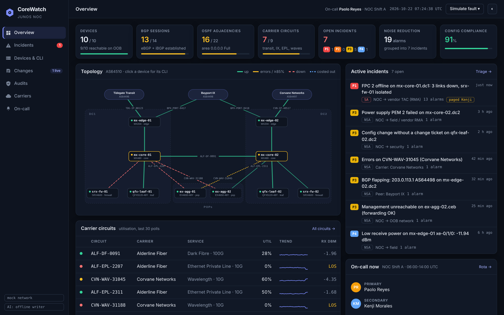
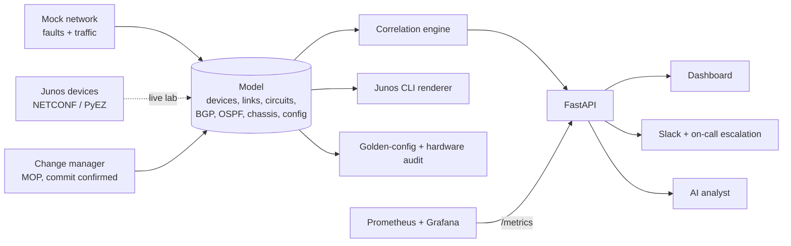

# CoreWatch

A NOC console for Junos core and edge networks. CoreWatch watches routers, switches, firewalls and carrier circuits.
It groups their alarms into a few incidents with the evidence behind each one, and lets you verify each incident with
real Junos commands. It writes MOPs with `commit confirmed` and rollback, audits every device against a golden
configuration, and pages the on-call engineer.

> **Simulated network.** Every device, carrier, circuit ID, person and site is fictional. ASNs come from the
> documentation range (RFC 5398) and IP addresses from RFC 5737 / RFC 1918. CoreWatch is not affiliated with any
> vendor. It can also poll real or virtual Junos devices over NETCONF (see [Live lab mode](#live-lab-mode)).



## What it covers

| NOC responsibility | In CoreWatch |
| --- | --- |
| Manage and maintain the monitoring system | Live view of 10 devices (MX480, MX204, SRX4600, QFX5120, EX4650): interfaces, optics, BGP, OSPF, chassis alarms, RE CPU, temperature. Prometheus exporter and a provisioned Grafana dashboard |
| Fault troubleshooting and problem isolation | A correlation engine that turns raw alarms into root-cause incidents with evidence. One-click verification runs the right `show` commands |
| Work with third-party suppliers | Circuit inventory per carrier with SLA and NOC contacts. Carrier faults are drafted with the circuit ID, account and optical readings, and tracked against the SLA |
| BGP traffic engineering | Per-transit local-preference and AS-path prepend, with a before/after traffic prediction, shown on each edge router |
| Controlled core and edge changes (MOPs) | Generated MOPs with pre-checks, `set` commands, `show \| compare`, `commit confirmed 5`, post-checks and rollback. Four-eyes approval, automatic rollback if the commit is not confirmed, and alert suppression during the maintenance window |
| Hardware, serial number, security and configuration audits | 12 golden-config rules (SSH, telnet, SNMPv3, TACACS+, BGP auth, NTP, syslog, LLDP, rescue config, descriptions, approved Junos release). Serial numbers are compared with the asset register. Fixes become a MOP in one click |
| Custom monitoring plugins and graphing | `/metrics` exporter (`corewatch_*` series) and a Grafana dashboard loaded at startup |
| Documentation of procedures | Every incident type carries its own runbook: evidence, verify commands, recommended actions |
| Tier 3 escalation and 24x7 call-out | Weekly rotation, NOC shifts, an escalation policy per severity, acknowledgements and Slack paging |

## Correlation: one root cause instead of a page of alarms

When an FPC fails on a core router, the NOC sees 13 separate alarms. They include interfaces down on both ends, OSPF
adjacencies lost on both ends, two carrier circuits down, and a firewall that has gone unreachable. CoreWatch reports
**one P1 incident**: *FPC 2 offline on mx-core-01.dc1: 3 links down, srx-fw-01 isolated*.

Rules run from the most fundamental cause to the least. Each rule claims the symptoms it explains.

| Rule | Typical evidence | Severity |
| --- | --- | --- |
| Device down | No management response, every neighbour lost light at the same moment | P1 SA |
| FPC offline | Chassis alarm, every interface on that card down, other FPCs fine; devices isolated by it | P1 / P2 |
| Site isolated | All uplinks down, LOS both ends, names both carriers | P1 SA |
| All transit down | Both IP transit circuits and eBGP sessions down | P1 SA |
| Carrier circuit down | LOS, eBGP or OSPF lost over it, where the traffic moved and how full that path is now | P1–P3 |
| BGP down, link up | Interface up, clean optics, Hold Timer Expired; flags a commit made just before the drop | P2 / P3 |
| Circuit errors | CRC on receive only, receive power below baseline; BGP flaps on it folded in | P3 |
| PSU / fan / temperature | Chassis alarm, remaining redundancy, rising temperature | P2 / P3 |
| Low optics, high utilisation, RE CPU | Thresholds against baseline | P3 / P4 |
| Management-only outage | OOB unreachable but OSPF neighbours still Full | P3 |
| Config change without a ticket | Commit by a non-approved user, no CHG, `show \| compare rollback 1` | P3 security |

## Junos CLI, read-only

The Devices page has a console that renders Junos-style output from the model. Supported commands include `show interfaces terse`,
`show interfaces <if> extensive`, `show interfaces diagnostics optics`, `show bgp summary`, `show bgp neighbor`,
`show ospf neighbor`, `show route summary`, `show chassis alarms | hardware | environment | fpc | routing-engine`,
`show system commit | alarms | processes`, `show configuration | display set`, `show configuration | compare rollback 1`,
`show log messages`, `show lldp neighbors`, `show route advertising-protocol bgp`, `show route 192.0.2.128/25`, `ping` and `traceroute`. Pipes work too: `match`, `except`, `count` and `last`. Anything that
changes state is refused, because changes go through a MOP.

## Change control

`draft → approved (Tier 3, not the requester) → in progress (commit confirmed 5) → implemented → closed`

Templates:

- drain a transit or IX session for carrier maintenance (it warns if the remaining transit would run hot)
- BGP traffic engineering on an IP transit: AS-path prepend for inbound traffic, local-preference for outbound.
  The MOP writes the Junos `policy-options` change and predicts how many Gbps move to each circuit. Once it's
  committed, the traffic model, `show route advertising-protocol bgp` and `show route 192.0.2.128/25` all change
- cost out a core link with OSPF metric 65535
- upgrade Junos to the approved release
- golden-config fix generated from the audit

If nobody confirms within five minutes, the change rolls itself back, the same way Junos `commit confirmed` does.
Incidents on devices or circuits inside an implemented change are marked with the CHG and are not paged.

## AI analysis

For each incident, the analyst writes:

- a summary
- the likely cause with a confidence level
- next steps
- a NOC ticket
- a message to the carrier or peer
- an escalation note for Tier 3

With `ANTHROPIC_API_KEY` set, an LLM writes the analysis from the incident's structured data and is told not to
invent facts. Without a key, a built-in offline writer produces the same structure, so the demo always works. If the
model returns bad output, CoreWatch falls back to the offline writer automatically.

## Architecture



| Path | Purpose |
| --- | --- |
| `backend/app/models.py` | Device, interface, FRU, BGP, OSPF, link, circuit and carrier model |
| `backend/app/network.py` | Topology, Junos configs, protocol state derivation, traffic, fault injection |
| `backend/app/correlation.py` | Symptom collection and root-cause rules |
| `backend/app/junos_cli.py` | Read-only Junos CLI renderer with pipes |
| `backend/app/changes.py` | MOP templates, `show \| compare`, commit confirmed, rollback, maintenance windows |
| `backend/app/audit.py` | Golden-config rules with fix lines, hardware and software audit |
| `backend/app/oncall.py`, `slack.py` | Rotation, escalation policy, Slack alerts and pages |
| `backend/app/lab.py` | NETCONF collector: Junos RPC XML → model (LLDP topology, circuits from descriptions) |
| `backend/app/ai.py` | LLM analyst, offline writer, validation and fallback |
| `monitoring/` | Prometheus scrape config and the Grafana dashboard |
| `lab/` | Two-router containerlab topology for live mode |

## Run it

```bash
docker compose up --build                  # http://localhost:8000
docker compose --profile monitoring up     # + Prometheus :9090, Grafana :3000 (dashboard preloaded)

# without Docker
make install
make demo                                   # no random faults, escalations every 5 s: use the Simulate menu
make test && make lint
```

Optional extras go in `.env` (see `.env.example`): `ANTHROPIC_API_KEY` for LLM analysis, `SLACK_WEBHOOK_URL` for
real Slack messages.

A quick tour:

1. Overview shows six realistic open issues, including a carrier circuit with CRC errors and an unapproved commit.
2. Simulate fault → FPC offline on core router. Thirteen alarms become one P1 incident, and the on-call engineer is paged.
3. Open it, select **Run checks** to see the real Junos output, then **Analyse with AI** and acknowledge it.
4. On Changes, approve and implement the transit drain, then simulate the transit going down. The incident is tagged with
   the CHG and not paged.
5. On Audits, select **Create fix MOP** for `qfx-leaf-02` and walk it through to 100%.

## Live lab mode

Set `LAB_DEVICES="r1=172.20.20.2,r2=172.20.20.3"` with `LAB_USERNAME` and `LAB_PASSWORD` or `LAB_SSH_KEY`, then install
`backend/requirements-lab.txt`. CoreWatch then polls the devices with read-only RPCs:

- software, inventory and interfaces
- BGP, OSPF, alarms and LLDP
- routing engine and configuration

It builds the same model from that data, so correlation, audits, the CLI and metrics work on real devices. Topology
comes from LLDP; circuits come from interface descriptions written as `ROLE | far end | CID <id>`. `lab/` has a
two-router vJunos-router containerlab topology and instructions. The parsers are unit-tested against Junos XML fixtures.

## Settings

| Variable | Default | Meaning |
| --- | --- | --- |
| `RX_LOW_WARN_DBM` / `RX_LOW_ALARM_DBM` | `-10` / `-13` | Optic receive power thresholds |
| `CRC_PER_MIN` | `50` | Errors per minute that count as degradation |
| `UTIL_HIGH_PCT` / `RE_CPU_HIGH_PCT` / `TEMP_HIGH_C` | `85` / `85` / `60` | Performance thresholds |
| `ALERT_MIN_SEVERITY` | `P2` | Slack alerts and paging for P1..this |
| `ESCALATION_MINUTE_SECONDS` | `60` | Real seconds per escalation minute (lower for demos) |
| `SLACK_WEBHOOK_URL` / `SLACK_CHANNEL` | mock / `#noc-core` | Slack delivery |
| `AI_PROVIDER` / `AI_MODEL` | `auto` / `claude-sonnet-4-5` | Analyst provider |
| `SIM_ENABLED` / `SIM_INTERVAL_SECONDS` / `SIM_FAULT_CHANCE` | `true` / `15` / `0.12` | Simulator |
| `LAB_DEVICES`, `LAB_USERNAME`, `LAB_PASSWORD`, `LAB_SSH_KEY`, `LAB_POLL_SECONDS` | empty | Live lab mode |

## API

`/docs` has the OpenAPI reference. The main endpoints:

| Method | Path | Purpose |
| --- | --- | --- |
| GET | `/api/summary`, `/api/topology` | KPIs, on-call, compliance; devices, links, carriers |
| GET | `/api/incidents`, `/api/incidents/{id}` | Correlated incidents with evidence and verify commands |
| POST | `/api/incidents/{id}/verify` · `/analyze` · `/ticket` · `/carrier-ticket` · `/ack` | Triage actions |
| GET / POST | `/api/devices`, `/api/devices/{host}`, `/api/cli` | Inventory, device detail, read-only CLI |
| GET / POST | `/api/changes`, `/api/changes/templates`, `/api/changes/{id}/{approve,implement,confirm,rollback,close}` | Change control |
| GET / POST | `/api/audit`, `/api/audit/{host}/fix`, `/api/hardware` | Audits |
| GET | `/api/circuits`, `/api/oncall`, `/api/slack`, `/api/events` | Carriers, rota, notifications |
| POST | `/api/simulate/{fault}` | Demo faults, `tick`, `restore` |
| GET | `/metrics` | Prometheus |

## CI/CD

GitHub Actions runs `ruff` and `pytest`: 54 tests covering every correlation rule and fault type, the CLI renderer,
change lifecycle and auto-rollback, audits, escalation, Slack, the NETCONF parsers and the API. It then builds the
Docker image, smoke-tests the container, and pushes the image to GitHub Container Registry on `main`.

## Roadmap

- gNMI streaming telemetry instead of polling
- Syslog receiver to turn real Junos log messages (`SNMP_TRAP_LINK_DOWN`, `BGP_STATE_CHANGE`) into symptoms
- Push the approved MOP through NETCONF (`commit confirmed`) instead of handing it to an engineer
- Ticketing system and PagerDuty / Opsgenie integrations
- Anomaly detection on optics and error-rate history
